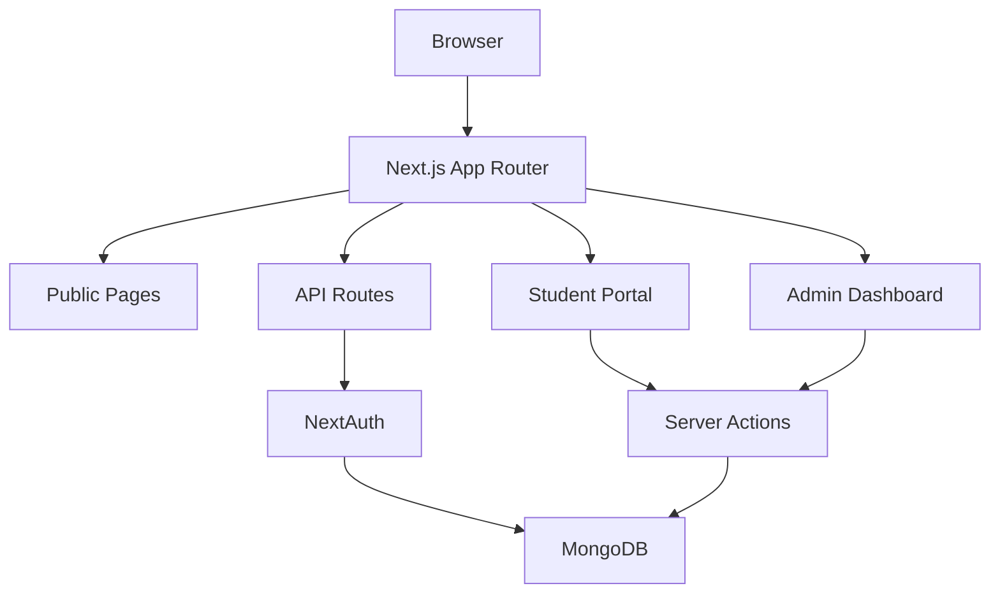

# CampusPulse — Project Walkthrough

> **Campus Event Management Platform** built with Next.js 16.3 + MongoDB + NextAuth
> Build Status: ✅ Production build passes | 21 routes | 50 source files

---

## Architecture Overview



## Tech Stack

| Layer | Technology |
|-------|-----------|
| Framework | Next.js 16.3.3 (Turbopack) |
| Language | TypeScript (strict) |
| Database | MongoDB + Mongoose |
| Auth | NextAuth.js (Credentials) |
| Styling | TailwindCSS + Custom CSS variables |
| Animations | Framer Motion |
| Icons | Lucide React |
| Fonts | Inter + Plus Jakarta Sans |

---

## File Structure (50 files)

### 📦 Models (5 files)
| File | Purpose |
|------|---------|
| [`User.ts`](file:///c:/Users/sabir/antigravity/src/models/User.ts) | User schema — name, email, bcrypt password, role (student/admin) |
| [`Event.ts`](file:///c:/Users/sabir/antigravity/src/models/Event.ts) | Event schema — title, slug, category, venue, registeredUsers[], mediaGallery, reportData |
| [`FeedbackForm.ts`](file:///c:/Users/sabir/antigravity/src/models/FeedbackForm.ts) | Dynamic feedback forms — questions[], published/accepting toggles |
| [`FeedbackSubmission.ts`](file:///c:/Users/sabir/antigravity/src/models/FeedbackSubmission.ts) | Individual student responses with anonymous option |
| [`EventQnA.ts`](file:///c:/Users/sabir/antigravity/src/models/EventQnA.ts) | Q&A questions with upvotes[], pinning, admin answers |

---

### 🔧 Library (3 files)
| File | Purpose |
|------|---------|
| [`connection.ts`](file:///c:/Users/sabir/antigravity/src/lib/db/connection.ts) | MongoDB singleton connection |
| [`auth-options.ts`](file:///c:/Users/sabir/antigravity/src/lib/auth/auth-options.ts) | NextAuth config with Credentials provider |
| [`rbac.ts`](file:///c:/Users/sabir/antigravity/src/lib/auth/rbac.ts) | Role-based access control — `getSession()`, `requireAdmin()` |

---

### ⚡ Server Actions (4 files)
| File | Key Functions |
|------|--------------|
| [`events.ts`](file:///c:/Users/sabir/antigravity/src/actions/events.ts) | `getEvents()`, `getEventBySlug()`, `createEvent()`, `updateEvent()`, `deleteEvent()`, `rsvpEvent()`, `cancelRsvp()`, `getAdminEvents()`, `getEventById()` |
| [`feedback.ts`](file:///c:/Users/sabir/antigravity/src/actions/feedback.ts) | `createFeedbackForm()`, `updateFeedbackForm()`, `getFeedbackFormById()`, `getFeedbackFormByEvent()`, `getAvailableFeedbackForms()`, `getAllFeedbackForms()`, `submitFeedback()`, `getFeedbackResponses()` |
| [`qna.ts`](file:///c:/Users/sabir/antigravity/src/actions/qna.ts) | `askQuestion()`, `upvoteQuestion()`, `answerQuestion()`, `getEventQuestions()`, `getAllQuestions()` |
| [`analytics.ts`](file:///c:/Users/sabir/antigravity/src/actions/analytics.ts) | `getDashboardStats()`, `getRecentEvents()`, `getCategoryDistribution()`, `getMonthlyEventData()` |

---

### 🧱 Components (11 files)

#### Layout Components
| File | Purpose |
|------|---------|
| [`Navbar.tsx`](file:///c:/Users/sabir/antigravity/src/components/layout/Navbar.tsx) | Top navigation — logo, links, auth state, theme toggle |
| [`Footer.tsx`](file:///c:/Users/sabir/antigravity/src/components/layout/Footer.tsx) | Footer with links, contact info, social |
| [`Sidebar.tsx`](file:///c:/Users/sabir/antigravity/src/components/layout/Sidebar.tsx) | Admin sidebar — navigation for dashboard sections |

#### UI Components
| File | Purpose |
|------|---------|
| [`EventCard.tsx`](file:///c:/Users/sabir/antigravity/src/components/ui/EventCard.tsx) | Animated event card with category badge, date, venue, capacity bar |
| [`StatsCard.tsx`](file:///c:/Users/sabir/antigravity/src/components/ui/StatsCard.tsx) | Glassmorphism stat card with icon and animated counter |
| [`Modal.tsx`](file:///c:/Users/sabir/antigravity/src/components/ui/Modal.tsx) | Reusable modal overlay with backdrop close |
| [`LoadingSpinner.tsx`](file:///c:/Users/sabir/antigravity/src/components/ui/LoadingSpinner.tsx) | Animated spinner with text, configurable size, fullPage mode |
| [`EmptyState.tsx`](file:///c:/Users/sabir/antigravity/src/components/ui/EmptyState.tsx) | Empty state illustration with icon, title, description, optional CTA |
| [`FeedbackFormBuilder.tsx`](file:///c:/Users/sabir/antigravity/src/components/ui/FeedbackFormBuilder.tsx) | Drag-and-drop-style form builder — add/edit/reorder/delete questions |

#### Providers
| File | Purpose |
|------|---------|
| [`AuthProvider.tsx`](file:///c:/Users/sabir/antigravity/src/components/providers/AuthProvider.tsx) | NextAuth SessionProvider wrapper |
| [`ThemeProvider.tsx`](file:///c:/Users/sabir/antigravity/src/components/providers/ThemeProvider.tsx) | Dark/light theme context with localStorage persistence |

---

### 📄 Pages & Routes (21 routes)

#### Public Pages (5 static routes)
| Route | File | Features |
|-------|------|----------|
| `/` | [`page.tsx`](file:///c:/Users/sabir/antigravity/src/app/page.tsx) | Landing page — hero section, features grid, CTA |
| `/login` | [`page.tsx`](file:///c:/Users/sabir/antigravity/src/app/login/page.tsx) | Email/password login, Suspense-wrapped searchParams |
| `/register` | [`page.tsx`](file:///c:/Users/sabir/antigravity/src/app/register/page.tsx) | Registration with name, email, password |
| `/events` | [`page.tsx`](file:///c:/Users/sabir/antigravity/src/app/events/page.tsx) | Events grid — search, category filters, pagination |
| `/events/[slug]` | [`page.tsx`](file:///c:/Users/sabir/antigravity/src/app/events/%5Bslug%5D/page.tsx) | Event detail — RSVP, QR token, Q&A tab, upvoting |

#### Student Portal (4 routes, auth-guarded)
| Route | File | Features |
|-------|------|----------|
| `/portal/*` | [`layout.tsx`](file:///c:/Users/sabir/antigravity/src/app/portal/layout.tsx) | Auth guard — redirects to login if not authenticated |
| `/portal/feedback` | [`page.tsx`](file:///c:/Users/sabir/antigravity/src/app/portal/feedback/page.tsx) | Available feedback forms listing |
| `/portal/feedback/[formId]` | [`page.tsx`](file:///c:/Users/sabir/antigravity/src/app/portal/feedback/%5BformId%5D/page.tsx) | Fill feedback — ratings, MCQs, text, Likert, anonymous toggle |
| `/portal/qna` | [`page.tsx`](file:///c:/Users/sabir/antigravity/src/app/portal/qna/page.tsx) | Q&A across all events — ask, upvote, view answers |

#### Admin Dashboard (12 routes, admin-guarded)
| Route | File | Features |
|-------|------|----------|
| `/admin/*` | [`layout.tsx`](file:///c:/Users/sabir/antigravity/src/app/admin/layout.tsx) | Admin guard + sidebar layout |
| `/admin` | [`page.tsx`](file:///c:/Users/sabir/antigravity/src/app/admin/page.tsx) | Dashboard — 8 stat cards, recent events, category distribution bars |
| `/admin/events` | [`page.tsx`](file:///c:/Users/sabir/antigravity/src/app/admin/events/page.tsx) | Events table — search, status badges, view/edit/cancel actions |
| `/admin/events/new` | [`page.tsx`](file:///c:/Users/sabir/antigravity/src/app/admin/events/new/page.tsx) | Create event form — all fields with category/status dropdowns |
| `/admin/events/[id]/edit` | [`page.tsx`](file:///c:/Users/sabir/antigravity/src/app/admin/events/%5Bid%5D/edit/page.tsx) | Edit event — pre-filled form with save |
| `/admin/feedback` | [`page.tsx`](file:///c:/Users/sabir/antigravity/src/app/admin/feedback/page.tsx) | Feedback forms listing — publish status, question count |
| `/admin/feedback/[eventId]` | [`page.tsx`](file:///c:/Users/sabir/antigravity/src/app/admin/feedback/%5BeventId%5D/page.tsx) | Form builder — add questions, set types, toggle publish/accepting |
| `/admin/feedback/[eventId]/responses` | [`page.tsx`](file:///c:/Users/sabir/antigravity/src/app/admin/feedback/%5BeventId%5D/responses/page.tsx) | Response analytics — star averages, MCQ distribution bars, text answers |
| `/admin/analytics` | [`page.tsx`](file:///c:/Users/sabir/antigravity/src/app/admin/analytics/page.tsx) | Analytics — stats cards, monthly trend bars, SVG donut chart |
| `/admin/reports` | [`page.tsx`](file:///c:/Users/sabir/antigravity/src/app/admin/reports/page.tsx) | Event reports — downloadable text reports with attendance stats |
| `/admin/media` | [`page.tsx`](file:///c:/Users/sabir/antigravity/src/app/admin/media/page.tsx) | Media gallery — photos/videos by event with hover effects |

---

## Key Features

### 🎫 Event Management
- Create, edit, cancel events with category, venue, capacity, tags
- Auto-generated slugs for SEO-friendly URLs
- RSVP with unique QR code token generation
- Registration capacity tracking with progress bars

### 📝 Feedback System
- Dynamic form builder — rating, MCQ, text, Likert scale question types
- Publish/unpublish and open/close response collection toggles
- Anonymous submission option
- Response analytics with visual charts (star averages, distribution bars)

### 💬 Q&A System
- Students ask questions about events
- Upvoting system for question prioritization
- Admin answers with attribution
- Question pinning support

### 📊 Analytics Dashboard
- Real-time stats — events, users, registrations, attendance rate
- Monthly trend visualization with animated bars
- Category distribution with SVG donut chart
- Event-level report generation (downloadable)

### 🎨 Design System
- Dark/light theme with localStorage persistence
- Glassmorphism cards with backdrop blur
- Custom gradient mesh backgrounds
- Framer Motion animations throughout
- Responsive layout (mobile → desktop)
- Google Fonts (Inter + Plus Jakarta Sans)

### 🔒 Security
- NextAuth Credentials provider with bcrypt password hashing
- RBAC middleware — `student` and `admin` roles
- Server-side auth guards on portal and admin layouts
- API route protection

---

## Bug Fixes Applied

| Issue | Root Cause | Fix |
|-------|-----------|-----|
| `Github` icon not found | Removed from lucide-react | Changed to `ExternalLink` |
| CSS `@import` warning | Fonts import after tailwindcss | Moved fonts import first |
| `error.errors` undefined | Zod v4 API change | Changed to `error.issues` |
| Mongoose `category` type error | String not assignable to enum | Explicit cast to union type |
| `unknown` as ReactNode | React 19 strict type checking | `String()` wrapper for JSX children |
| `{unknown && <JSX>}` | React 19 rejects unknown in JSX | `{!!value && <JSX>}` pattern |
| Prerender ThemeProvider crash | No context during static gen | Safe default return |
| `useSearchParams` prerender | Missing Suspense boundary | Wrapped login page in `<Suspense>` |

---

## Build Verification

```
✅ Next.js 16.3.3 (Turbopack)
✅ Compiled successfully in 4.2s
✅ TypeScript — zero errors
✅ Static pages generated (17/17)
✅ 21 routes (5 static + 16 dynamic)
```

---

## Next Steps (Optional Enhancements)

Agar aur features add karne hain toh ye possible options hain:

1. **File Upload** — Event banners, media gallery uploads (S3/Cloudinary)
2. **Real-time Notifications** — WebSocket/SSE for Q&A updates
3. **Email Integration** — RSVP confirmations, event reminders
4. **Export Data** — CSV/PDF export for feedback responses
5. **QR Code Scanner** — Attendance marking via QR scan
6. **Search Engine** — Full-text search across events
7. **PWA Support** — Offline access, push notifications
